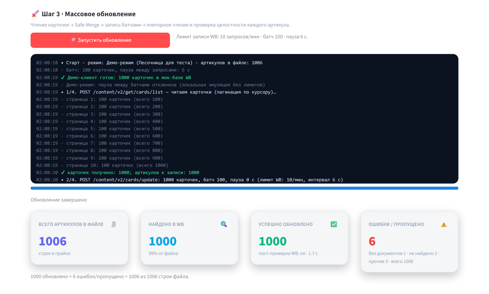
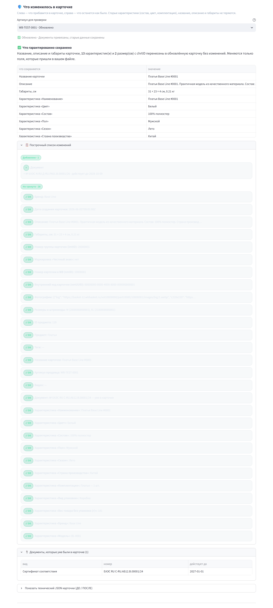
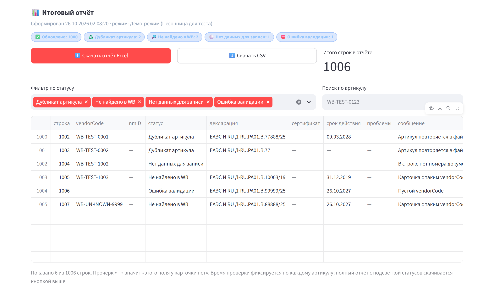

# WB Docs Updater — привязка документов к карточкам Wildberries без потери данных


> Массовая привязка деклараций и сертификатов соответствия к карточкам Wildberries
> через **Content API v2** — с двухэтапной проверкой целостности и полной эмуляцией
> WB в песочнице.

---

## О проекте: бизнес-задача

Селлер получает с десяток деклараций и сертификатов в месяц и должен прикрепить
их к сотням карточек. Руками — часы монотонной работы. Скриптом — риск потерять
товар.

Причина в поведении API. Метод `POST /content/v2/cards/update` **не** обновляет
отдельные поля: он **полностью перезаписывает** контейнеры карточки — массивы
`characteristics`, `sizes`, `dimensions` и объект `documents`. Отправили только
номер декларации — получите карточку, в которой стёрты:

- габариты и вес (`dimensions`);
- размеры с `chrtID` и баркоды (`sizes`);
- название и описание;
- все прежние характеристики — цвет, состав, комплектацию, страну производства;
- ранее прикреплённые документы.

Восстановить это из интерфейса WB нельзя: перезапись необратима. Ошибка в
скрипте обновления стоит карточке поисковых позиций, а селлеру — дней на ручное
восстановление.

**Проект решает именно эту проблему** — строгим алгоритмом `Safe-Merge` с
верификацией целостности до и после записи. Вместо «писать что есть» приложение
строит полный слепок карточки, точечно меняет только нужные характеристики и
проверяет, что всё остальное осталось на месте.

---

## 📸 Интерфейс приложения

### 1. Массовое обновление: живой лог и метрики прогона



Прайс на **1006 артикулов**, из них **1000 найдено и обновлено**, **6** попали в
«ошибки/пропущено» (дубликаты, пустой артикул, отсутствующие в WB, без
документов). Лог показывает каждый этап: чтение по курсору (10 страниц по 100
карточек), запись 10 батчами по 100, повторное чтение для пост-проверки.
Плитки метрик всегда сходятся: `1000 обновлено + 6 ошибок/пропущено = 1006 из
1006 строк файла` — ни одна строка прайса не теряется молча.

### 2. Инспектор: что изменится в карточке



Главный экран доверия. Сверху — таблица **«Что гарантированно сохранено»**:
название, описание, габариты `31 × 23 × 4 см`, состав, цвет, пол, сезон, страна
производства и размеры с `chrtID`. Ниже — построчный список изменений: что
**добавлено** (одна строка «Документ» с номером и сроком вместо четырёх
технических путей) и что **не тронуто** с бейджами `✓ ОК`. Внизу — спойлер
«Документы, которые уже были в карточке»: реальная таблица
**вид / номер / действует до**.

Инспектор доступен и для техкарточного состояния: спойлер JSON показывает сырые
ответы API *ДО* и *ПОСЛЕ* слияния.

### 3. Итоговый отчёт с фильтрами и разбором ошибок



Сводка по статусам одним взглядом, фильтр по статусу и поиск по артикулу.
Таблица ошибок отвечает на вопрос «почему эта строка не записалась»:
`Дубликат артикула`, `Не найдено в WB`, `Нет данных для записи`, `Ошибка
валидации`. Отчёт выгружается в **Excel с подсветкой статусов** или в **CSV**.

---

## Ключевые возможности и инженерные решения

### Алгоритм Safe-Merge + двухэтапная проверка `verify_integrity`

Слияние — это не «дописать поле», а сохранение всего, что уже есть:

1. **Полный слепок карточки.** `POST /content/v2/get/cards/list` с курсорной
   пагинацией (`updatedAt` + `nmID`): вычитываем карточки продавца целиком, а не
   по одной.
2. **Точечное слияние по реальным `charcID`.** Список характеристик предмета
   берётся из `GET /content/v2/object/charcs/{subjectID}`. Документные
   характеристики («Номер декларации соответствия», «Номер сертификата
   соответствия», «Срок действия документа») обновляются по своему `charcID`, а
   не по угаданному имени — WB иначе вернёт `400`. Всё, что не пришло в прайсе,
   копируется в отправляемый объект без изменений.
3. **Предпроверка инвариантов до отправки.** `verify_integrity(before, after,
   row)` сверяет `nmID`, `imtID`, `vendorCode`, `title`, `description`,
   `dimensions`, каждый `chrtID` размеров с баркодами и все «непричастные»
   характеристики. Расхождение — карточка не уходит в WB вовсе.
4. **Пост-проверка после записи.** Повторное чтение подтверждает, что документы
   применились и данные целы. Не применилось — статус `🟠 Не применено на WB`, а
   не ложно зелёный `✅`.

Отдельная защита: при смене документа **чужой `endDate` не переносится**. Срок
прежнего документа относится к прежнему номеру, поэтому даты берутся только из
строки прайса.

### Уважение к лимитам WB API (`RateLimiter`)

- **Батчинг по 100 карточек** — ровно `UPDATE_BATCH_LIMIT`, который принимает
  `POST /content/v2/cards/update`.
- **Контроль квот:** 10 запросов/мин на запись (интервал 6 с) и 100/мин на
  чтение.
- **`429 Too Many Requests`** — пауза по заголовку `Retry-After`, затем повтор.
- **`5xx`** — экспоненциальный backoff с ограничением числа попыток.
- **Кооперативная отмена** через `stop_event`: прогон останавливается на границе
  батча, уже отправленное не теряется, отчёт по выполненным артикулам сохраняется.

### Песочница (Demo Mode) и Dry-Run

- **Демо-режим** работает без токена: встроенная мок-база из **1000 карточек**
  (`mock_wb_cards.json`) в формате реального ответа API, включая «грязные»
  строки — дубликаты артикулов, пустые артикулы, битые даты, просроченные
  документы, несуществующие товары. Полный цикл «чтение → слияние → запись →
  пост-проверка» выполняется в памяти за секунды.
- **Dry-Run** проходит всё слияние и валидацию, но не вызывает
  `POST /content/v2/cards/update` — безопасный способ посмотреть план на боевом
  токене.

---

## 🧪 Тестирование и надёжность

```
162 passed in 85.63s
wb_client.py  1092 stmts  139 miss  87%
```

**162 автотеста** в `pytest`, покрытие ядра `wb_client.py` — **87%**.

Ключевой инструмент — кастомный **`InMemoryWBBackend`**: фейковый сервер WB API,
который в точности воспроизводит поведение настоящего без походов в сеть:

- **полная перезапись контейнеров** — отправили карточку без `sizes`, размеры
  исчезли, ровно как у живого API;
- **пагинация по курсору** — следующая страница определяется `updatedAt` +
  `nmID`, поэтому тест ловит ошибки курсора, которые на моках «в одну страницу»
  не видны;
- **эмуляция ошибок** — `429` с `Retry-After`, `5xx`, невалидный токен.

Примеры покрытых кейсов:

| Кейс | Что проверяется |
| --- | --- |
| Сохранность `chrtID` | После слияния все размеры и баркоды на месте — WB не получил карточку без `sizes` |
| Неперенос чужого `endDate` | При замене документа старый срок не «прилипает» к новому номеру |
| Идемпотентность | Второй прогон по тому же прайсу даёт `Без изменений` и не отправляет ни одного POST |
| Обрыв на `429` посреди батча | Валидные батчи уже записаны, прогон продолжается после `Retry-After`, отчёт сходится |
| Курсорная пагинация | Демо-клиент не «перештамповывает» `updatedAt`, иначе курсор поедет |
| Тексты UI | Русские названия полей вместо `charcID 15001135`, метрики без расхождений |

Отдельно проверяется, что `mock_wb_cards.json` из репозитория проходит
Safe-Merge и `verify_integrity` на реальном наборе карточек.

```bash
pip install -r requirements-dev.txt
python -m pytest                                    # 162 passed
python -m pytest --cov=wb_client --cov-report=term  # wb_client.py 87%
```

---

## Быстрый старт

```bash
git clone https://github.com/leyylin/wb-docs-updater.git
cd wb-docs-updater

# зависимости приложения
pip install -r requirements.txt

# зависимости для тестов (включают requirements.txt)
pip install -r requirements-dev.txt

streamlit run app.py
```

Приложение откроется на `http://localhost:8501`.

### Первый запуск без токена

1. В сайдбаре оставьте режим **«Демо-режим (Песочница для теста)»**.
2. Нажмите **«Загрузить в память»** — подставится тестовый прайс на 1000
   артикулов.
3. Нажмите **«Запустить обновление»** — прогон пройдёт на мок-базе за пару
   секунд.

Для боевого режима переключите радио на **«Боевой режим (WB API Token)»** и
вставьте токен категории **«Контент»** (Личный кабинет WB → Настройки → Доступ к
API). Ключ хранится только в памяти сессии.

### Формат прайса

Excel (`.xlsx`), первая строка — заголовки:

| vendorCode | declaration_number | certificate_number | expiry_date |
| --- | --- | --- | --- |
| WB-TEST-0001 | ЕАЭС N RU Д-RU.РА01.В.00001/26 | ЕАЭС RU С-RU.АБ12.В.00001/26 | 31.12.2028 |

Поддерживаются русские заголовки (`артикул`, `декларация`, `сертификат`, `срок
действия`) и разные форматы даты: `31.12.2028`, `31/12/2028`, `2028-12-31`,
`31 декабря 2028`, дата Excel.

---

## Статусы в отчёте

| Статус | Значение |
| --- | --- |
| ✅ Обновлено | Документы записаны, пост-проверка пройдена |
| 🟦 Без изменений | Значения из файла уже привязаны к карточке |
| 🟡 Требует проверки | В предмете нет подходящей характеристики / целостность не подтверждена |
| 🟠 Не применено на WB | API принял запрос, но повторное чтение не показало изменений |
| 🔎 Не найдено в WB | Артикула нет среди карточек продавца |
| ⚪ Нет данных для записи | Не указан ни один номер документа |
| ⛔ Ошибка валидации | Пустой/некорректный артикул, неверная дата |
| ♻️ Дубликат артикула | Артикул повторяется в файле, применена первая строка |
| 🔑 Ошибка токена | Токен не принят API |
| ❌ Ошибка API | Ошибка запроса (сеть, лимит, 4xx/5xx) |

---

## Структура проекта

| Файл | Назначение |
| --- | --- |
| `app.py` | Дашборд Streamlit: сайдбар, метрики, инспектор диффа, отчёт |
| `wb_client.py` | API-клиент, `safe_merge`, `verify_integrity`, `RateLimiter`, демо-клиент |
| `sample_generator.py` | Генератор тестового Excel и мок-базы карточек WB |
| `tests/` | pytest: Safe-Merge, сеть и лимиты, Excel, интеграция, тексты UI |
| `mock_wb_cards.json` | Мок-база из 1000 карточек в формате ответа WB |
| `sample_documents.xlsx` | Сгенерированный тестовый прайс на 1000 артикулов |
| `assets/` | Скриншоты интерфейса для README |
| `requirements.txt` / `requirements-dev.txt` | Зависимости приложения / тестов |

Проверить логику без интерфейса: `python wb_client.py` — самопроверка Safe-Merge.
